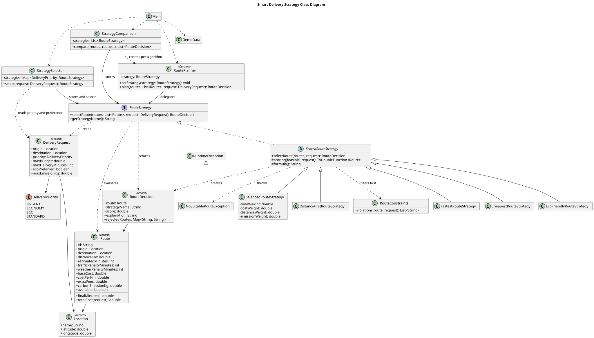
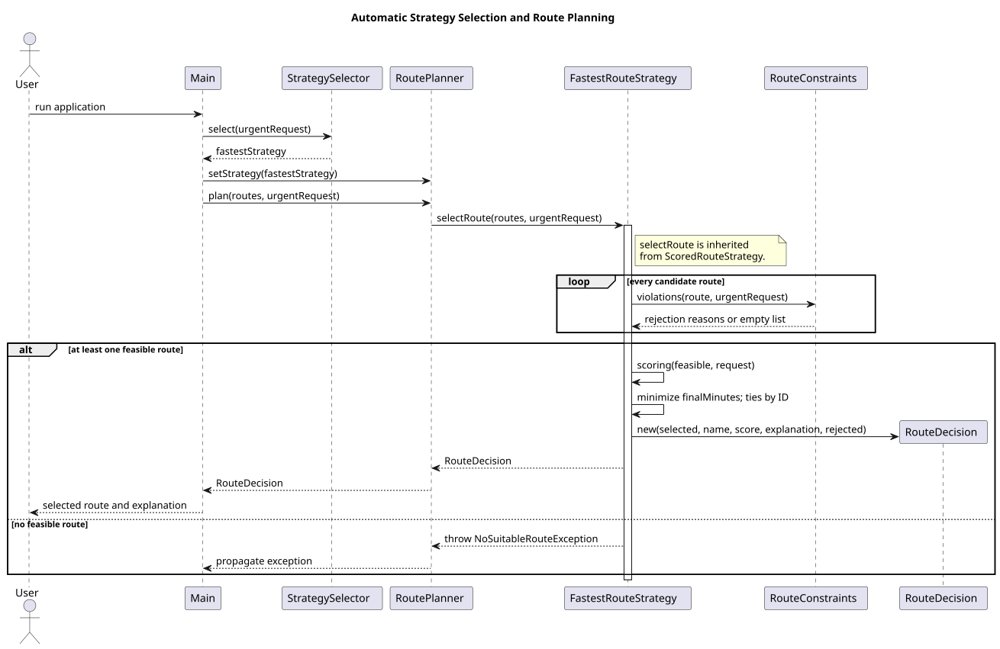

# Smart Delivery

Assignment 5 — Strategy Pattern. Java 17, Maven, JUnit 5.

The program selects a delivery route from eight candidates. Strategy allows changing the selection algorithm without changing the route planner.

## Run

```sh
mvn clean test
mvn package
java -cp target/classes delivery.Main
```

In IntelliJ, open `pom.xml` and run `delivery.Main`.

## Architecture

| Role | Class |
| --- | --- |
| Context | `RoutePlanner` |
| Strategy interface | `RouteStrategy` |
| Concrete strategies | `FastestRouteStrategy`, `CheapestRouteStrategy`, `EcoFriendlyRouteStrategy`, `BalancedRouteStrategy`, `DistanceFirstRouteStrategy` |
| Automatic selection | `StrategySelector` |
| Comparison | `StrategyComparison` |
| Domain model | `Location`, `Route`, `DeliveryRequest`, `DeliveryPriority` |
| Result | `RouteDecision` |

`RoutePlanner` delegates to `RouteStrategy`. It does not contain selection algorithms or checks for concrete strategy types. This is Strategy rather than a chain of algorithm-specific if/else branches.

`ScoredRouteStrategy` contains common filtering and result construction. Each concrete strategy defines its score. `RouteDecision` returns the route, score, explanation and rejection reasons together.

## Strategies

The lowest score wins. Equal scores are resolved by route ID.

- **Fastest:** estimated minutes + traffic penalty + weather penalty.
- **Cheapest:** `(baseCost + distanceKm * costPerKm + extraFees) * priorityMultiplier`. The multiplier is 1.2 for urgent deliveries and 1.0 otherwise.
- **Eco:** `carbonEmissionKg * 0.8 + distanceKm * 0.2`. These are simulation coefficients. The formula belongs in this strategy because it defines the environmental tradeoff.
- **Balanced:** normalized time, cost, distance and emissions multiplied by their weights, then added together. Default weights: 0.4, 0.3, 0.1, 0.2.
- **Distance first:** minimum distance.

Balanced uses `(value - min) / (max - min)` over feasible routes. If min equals max, the normalized value is zero. Weights must be finite, non-negative and sum to 1 within `1e-9`.

## Constraints and errors

Routes are rejected before scoring if they are unavailable, have different endpoints, exceed the budget or emission limit, or miss the deadline. Cost includes the surcharge, and delivery time includes penalties. Exact limits are accepted.

An empty list or no valid route causes `NoSuitableRouteException`. Invalid route values and Balanced weights cause `IllegalArgumentException`. Missing required objects cause `NullPointerException`. Three failure examples are handled in `Main`.

## Runtime switching and selection

`Main` uses one planner and switches three times: Fastest → Cheapest → Eco → Balanced.

`StrategySelector` receives a map: URGENT → Fastest, ECONOMY → Cheapest, ECO → Eco, STANDARD → Balanced. An eco preference selects Eco unless the request is urgent.

The selector decides which algorithm to use. The strategy decides how to select a route. Requests also affect filtering: reducing the deadline from 60 to 35 minutes changes the demo's Eco result from C to E.

## Comparison

All five strategies receive the same standard request: budget 10000, deadline 60 minutes, emission limit 10 kg.

| Strategy | Route | Minutes | Cost | Distance km | CO2 kg | Score |
| --- | --- | --- | --- | --- | --- | --- |
| Fastest | B | 22 | 4300 | 14 | 5 | 22 |
| Cheapest | D | 40 | 1100 | 12 | 3 | 1100 |
| Eco | C | 42 | 1800 | 8 | 0.8 | 2.24 |
| Balanced | H | 33 | 2460 | 11 | 1.5 | 0.410137 |
| Distance first | E | 33 | 2880 | 6 | 2 | 6 |

Scores from different strategies have different meanings. Each result explains its formula, metrics and rejected routes. Full console output: [example-output.txt](docs/example-output.txt).

## Adding a strategy

Extend `ScoredRouteStrategy` or implement `RouteStrategy`, define the algorithm, register it in `Main`, and add tests.

The fifth strategy was added in a separate commit. It added `DistanceFirstRouteStrategy` and three tests. Only `Main` changed to register it for comparison; `RoutePlanner` did not change.

## SOLID and Bridge

- **SRP:** planning, strategy selection, constraints and scoring have separate responsibilities.
- **OCP:** a new strategy can be added without changing the Context.
- **DIP:** `RoutePlanner` depends on the `RouteStrategy` interface.

Strategy replaces algorithms for one task. Bridge separates two independently changing hierarchies, such as service types and transport implementations.

## Tests

**31 tests passed, 0 failures, 0 errors, 0 skipped.**

The tests cover all five strategies, switching, automatic selection, constraints, budgets, deadlines, invalid weights, no valid route, comparison, boundary values and failures.

Maven results: [test-results.txt](docs/test-results.txt).

## UML





PlantUML sources and PNG versions are in `docs`.

## Limitations

The program selects predefined routes; it does not calculate paths on a real map. Traffic and emissions are sample data. Balanced rankings depend on the candidate set. Money uses `double`. The planner is intended for single-threaded use.
